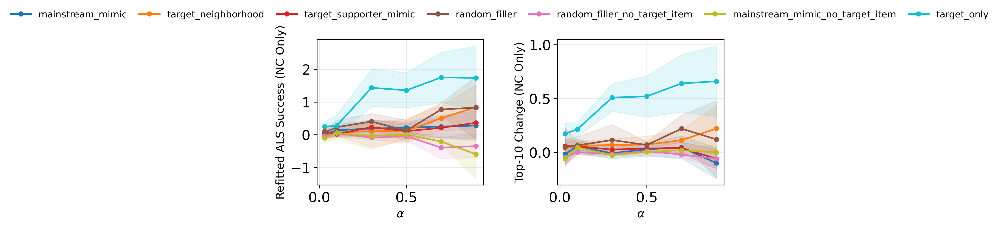
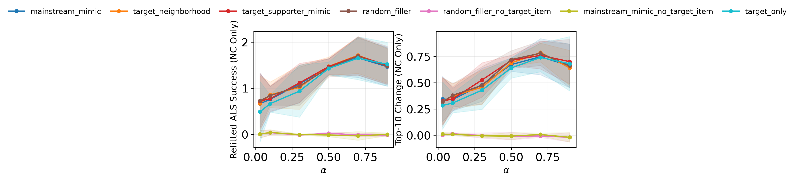
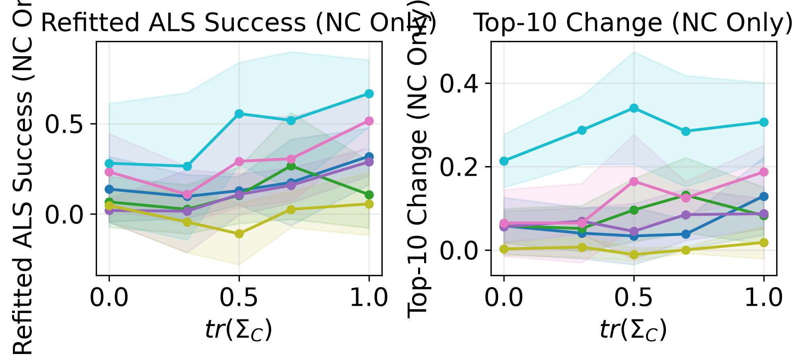
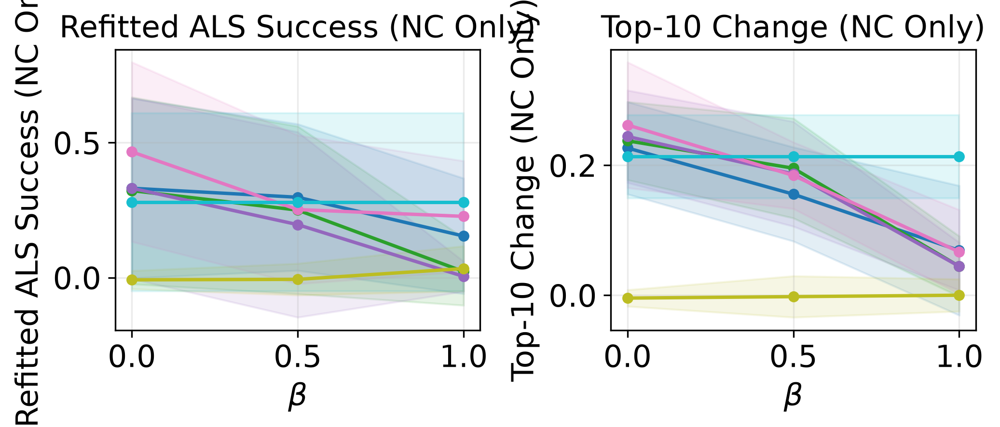
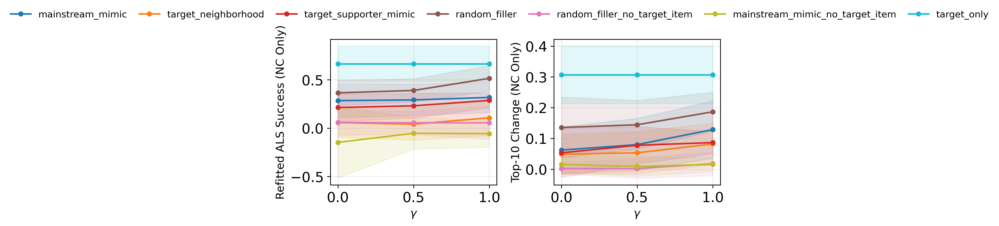

Below we showcase the plotted results associated with metrics calculated exclusively on non-collective members over our heuristic strategies. 

# Heuristic details 
To ensure that we can adequately understand the impact of specific heuristics, we add three additional baselines: mainstream_mimic_no_target_item (which, as the name suggests simply uses the mainstream mimic technique to select all strategic items and explcitly excludes the target item), random_filler_no_target_item (which randomly chooses items to strategically uprank), and target_item_only which is used to distinguish the impact of adding filler items. 

# Finding 1: Upvoting target item is the most effective technique for increasing exposure
Below, we visualize the findings over all $\alpha$ for the "clone" setting of $\beta=1.0, \Sigma_C = 0$

# Finding 2: Even under the completely non-unified setting, some success can be achievable

Below, we visualize the findings for the completely non-unified setting: $\beta=0.0, \Sigma_C = 1.0, \gamma=1.0$. We can see clearly that the collective is able to achieve some success on both downstream metrics.

# Finding 3: Higher heterogeneity seems to improve the collective's success

Below, we isolate for $\alpha=0.1, \beta=1.0, \gamma=1$. Here, we vary the heterogeneity of the collective. We can see that as heterogeneity $\Sigma_C$ increases, so does the success over the non-collective. We hypothesize that greater dispersion increases the likelihood that the collective's strategic actions will influence the model to believe that the target item is more broadly liked, triggering popularity bias. We hope to investigate this hypothesis more concretely in the revised version of our camera ready. 

# Finding 4: Similarly to our findings calculating over the entire collective, it seems that greater coordination over the heuristic strategies decreases the performance. 
Below, we vary $\beta$ in the setting where $\Sigma_C = \gamma = 0$ and $\alpha=0.1$. We can see that while the target item and baselines remain relatively stable irrespective of coordination, the heuristics decrease in their influence over the non-collective members. 

# Finding 5: Similarly to our findings calculating over the entire collective, it seems that $\gamma$ has less impact than the initial cohesion $\Sigma_C$ and coordination $\beta$.
Below, we showcase the findings for $\beta=1.0, \Sigma_C = 1.0, \alpha=0.1$. We can see that, even for a fully coordinated collective, increasing the heterogeneity can slightly improve performance. 

