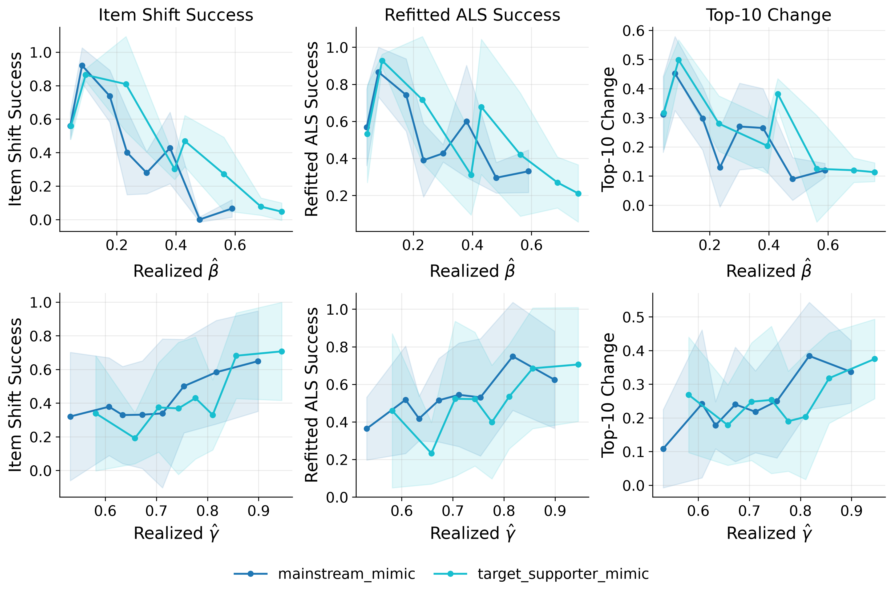

# Plotting realized parameters $\hat\beta, \hat\gamma$ as they relate to downstream metrics. 

Below, we report performance on the "realized" parameters $\hat\beta, \hat\gamma$ in the setting where $\alpha=0.1, \Sigma_C = 0.0$. Just for clarity, we present two of the most "realistic" heuristics. However, we also provide the plots for the remaining heuristics in this folder. 

We can see that, even with imperfectly realized coordination, we can see that the coordination trend (perfect coordination seems to yield lower performance for the strategies we're studying) persists. We wish to note that since $\gamma$ is a scaling parameter on the initial heterogeneity $\Sigma_C$, setting this parameter to 0 means that the $\hat\gamma$ values should remain relatively unaffected and unable to rise. 

We also present the results for a heterogeneous collective by setting $\alpha=0.1, \Sigma_C = 0.5$. We believe that these plots, too, confirm our findings from the perfect parameter plots presented in Figure 3 of our paper. We can see that increased coordination seems to lower success and higher heterogeneity (seen in realized $\hat \gamma$ values) increases success. 

