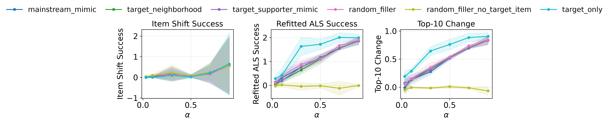
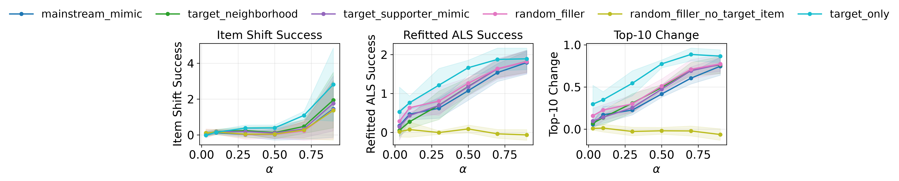

In an attempt to make sure that all the results were fully updated when considering figure 3(a) and 3(b), we reran the entire pipeline and removed the optimal lines from the graphs for better visualization. 

Below, we concretely compare a fully cohesive and coordinated collective with a heterogeneous and uncoordinated one. 

Crucially, the goal of this comparison is to strengthen the key findings of our work, which is that full cohesiveness and coordination may not necessarily achieve the highest success. Our goal is to motivate the explicit formulation of heterogeneity (both initial and action-induced) in the approximation of a collective's success. 

As we can see from these plots, relaxing the cohesion and coordination assumptions can actually achieve higher success in the Item-Shift Success. 